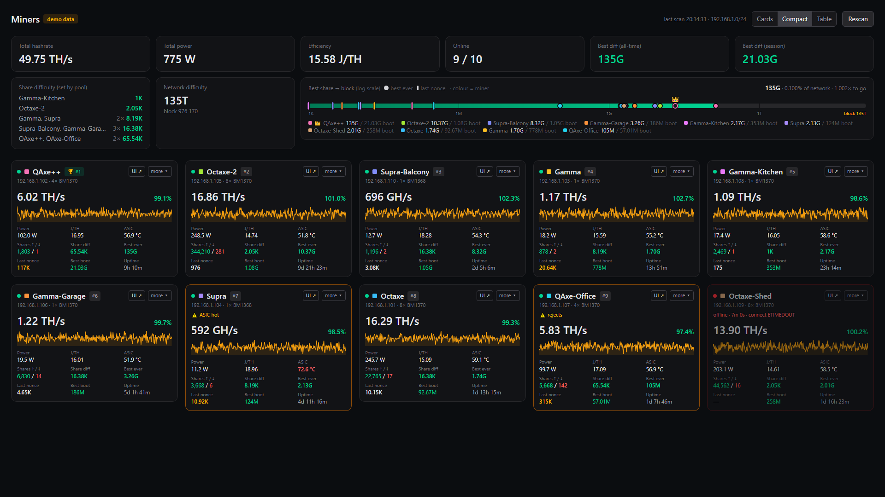
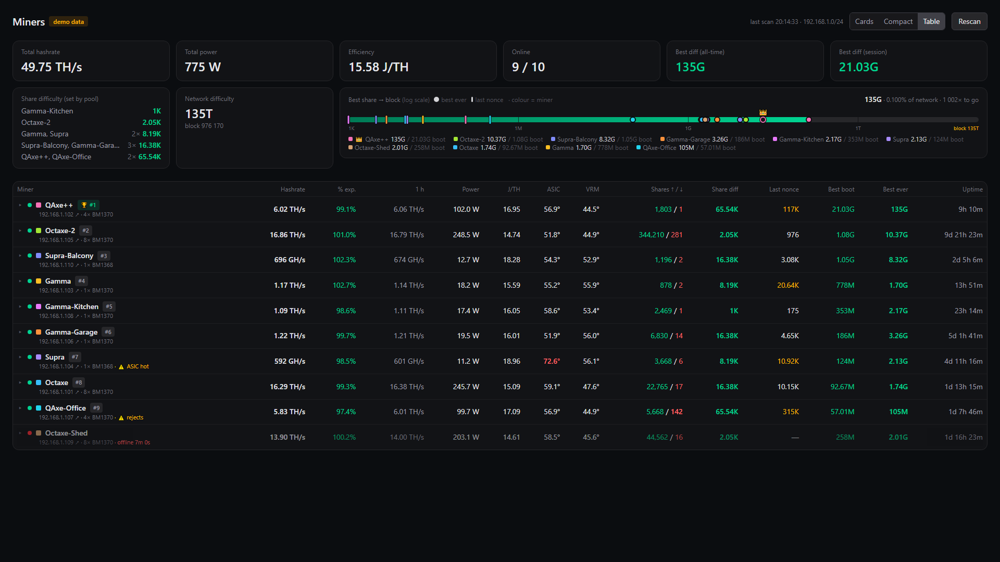
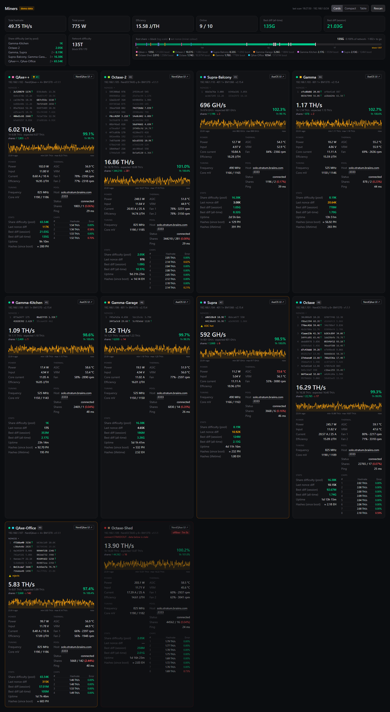

# Miner Dashboard

A local dashboard for home Bitcoin miners running AxeOS (Bitaxe) and NerdQAxe firmware.
Next.js (App Router), no database, no auth, no Docker. Read-only: it never changes miner settings.
Runs on a Windows PC or 24/7 on an [old Android phone](#running-on-an-old-android-phone).

Screenshots show 10 made-up miners from the [demo mode](#demo-mode).

**Compact** (the default with more than 6 miners): all miners on one screen.



**Table**: one row per miner.



**Cards**: everything about every miner (live nonces, chips, pool, tuning).



## Supported miners

Anything that exposes the AxeOS HTTP API (`GET /api/system/info`, no auth):

- **Bitaxe** (stock AxeOS): Gamma, Supra, Ultra, etc.
- **NerdQAxe / NerdQAxe++ / NerdOctaxe** (NerdQAxe firmware). These also expose
  `/api/v2/dashboard`, which adds per-chip hashrate and error stats, input current limits,
  pool connection state and more.

Tested with a NerdOctaxe (8× BM1370) and a NerdQAxe++ (4× BM1370) on NerdQAxe v1.1.1,
and a Bitaxe Gamma 601 on AxeOS v2.15.

## Features

- Three views, switched in the header (the choice is remembered in the browser):
  - **Cards**: full cards; 3 columns for up to 3 miners, 4 columns for more (fewer on a narrow
    window, a card is never narrower than 440 px). Under the chart each card has three
    collapsed blocks: **parameters** (power, thermal, tuning, pool), **stats · chips** and
    **live nonces**. Opening a block opens it on the cards of the same row (remembered in the
    browser), and each block starts on the same line in all cards of a row.
  - **Compact**: small cards with hashrate, % of expected, chart, power, J/TH, ASIC temperature,
    shares, share difficulty, last nonce, best nonce of the last 10 minutes, best share since boot
    and ever, uptime; "more" opens the full card in place. This is the
    default when there are more than 6 miners.
  - **Table**: one row per miner; click the name to open its full card under the row.
- Leaderboard: miners are ordered by their best share since boot, the leader gets a 🏆 #1 badge,
  the others #2, #3… Offline miners go last. When a miner climbs the leaderboard its card
  glows green for a few seconds.
- Problems are flagged with an amber border and a "⚠" line (they don't change the order):
  pool disconnected, fallback pool, ASIC ≥ 70 °C, VRM ≥ 80 °C, 1 h hashrate below 85% of
  expected, rejects above 1%, current above 98% of the max. Offline miners get a red border
  and are dimmed, their last known data marked as stale.
- Summary: total hashrate, total power, overall J/TH, miners online, best difficulty
  (all-time and session).
- Difficulty row: each miner's share difficulty (set by the pool; miners with the same
  difficulty share one line), the network difficulty
  with the current block height, and a log-scale bar from share to block difficulty
  marking every miner in its own colour (a square next to its name on the cards, in the table
  and in the bar's legend): a filled dot is the best share ever, a ring the best since boot
  (with more than 6 miners only the leader's ring), a thin tick the newest nonce, hopping
  along the bar as new nonces come in. A 👑 crown sits over the leader's ring. The bar starts
  two orders of magnitude below the lowest share difficulty, so nonces that were found but
  not sent to the pool spread out in the darker zone left of the "share" line.
- Best share log at the bottom of the page: every new best share since boot (skipping the first
  10 minutes after a miner reboots), 🏆 when it also beat the all-time best. Kept in
  `data/best-shares.json`, so records survive miner reboots. The last best shares of every miner
  are saved too (`data/best-last.json`): a record found while the dashboard was stopped is
  logged when it starts again, marked "while off" (if the miner rebooted meanwhile, only a new
  all-time best can be told apart).
- Notifications: 🔔 in the header turns on browser notifications (while the tab is open) for
  new problems and new best shares. Without a browser, the server can send the same alerts to
  Telegram, see [Data and configuration](#data-and-configuration); a problem has to last a
  minute before it is reported, and its recovery is reported too.
- A card per miner (name, hashrate and chart always visible; the rest in collapsed blocks):
  - online/offline status (offline after 30 s without a response)
  - current and 1 h hashrate vs expected (`frequency × smallCoreCount × asicCount / 1000`)
  - power, input voltage, current (highlighted above 98% of the max current), J/TH
  - ASIC/VRM temperature, fans
  - frequency, core voltage in mV (set / actual)
  - pool: host, connected, fallback in use, accepted/rejected shares and reject %, ping; the host links
    to the pool's stats page for the wallet in the stratum user (Braiins Solo:
    `solo.braiins.com/stats/<address>`, ckpool solo: `<host>/users/<address>`; other pools: no link)
  - difficulty of the newest nonce, live from the nonce feed (amber when it was sent to the
    pool as a share), and the best nonce of the last 10 minutes (every nonce counts, not only
    the shares); both also in the compact cards and the table
  - best difficulty, uptime; hashes computed since boot (estimate: average hashrate × uptime)
    and, on AxeOS 2.x, the exact lifetime counter `totalHashes` (NerdQAxe does not report one)
  - link to the miner's own web UI (AxeOS / NerdQAxe), opens in a new tab
  - live nonce feed at the bottom of the card, collapsed by default: one row per chip (numbered like the chip table) with the
    last 4 nonces that chip found and their difficulty, so 8×4 on a NerdOctaxe, 4×4 on a
    NerdQAxe++, 1×4 on a Bitaxe (each chip's 4 become 2×2 when the card is too narrow);
    ↑ share accepted by the pool, ↓ rejected (hover for the reason), → waiting for the answer,
    no mark: below the pool difficulty, not sent
  - shares since boot (accepted ↑ / rejected ↓) next to the hashrate
  - hashrate chart for the last 24 h (plain SVG); periods with no data (PC asleep, miner
    offline) are shown as a grey "no data" band instead of a line across the gap. **7d / 30d**
    switch to the long history (15-minute averages kept in `data/history-long.json`) with the
    ASIC temperature as a second, blue line
  - per-chip table (NerdQAxe firmware): hashrate and error % per chip, colored
    green (0%), yellow (≤ 0.5%) or red (> 0.5%)

## How it works

- **Discovery.** The server detects the local /24 subnet(s) from the network interfaces,
  skipping virtual adapters (Hyper-V `vEthernet`, WSL, VirtualBox, VPNs). If none qualify,
  it falls back to `192.168.68.0/24` (the author's network; override it with `SCAN_SUBNETS`).
  All 254 addresses are probed with `GET /api/system/info`, at most 32 requests in parallel
  with a 1.5 s timeout. A response with `hashRate` and `ASICModel` counts as a miner. If
  `/api/v2/dashboard` also answers, the miner is typed `nerdqaxe`, otherwise `axeos`.
- **Miner list** is stored in `data/miners.json`. Miners are identified by MAC address
  (`macAddr`), falling back to hostname, so a new DHCP address updates the existing entry
  instead of creating a duplicate.
- **When it scans:** on startup if `data/miners.json` doesn't exist; when you press **Rescan**;
  and automatically when a miner hasn't answered for over a minute (at most once every
  5 minutes), to find it at its new address. If another device now answers on a miner's old IP,
  its data is not shown under that miner's name.
- **Polling.** Only the server talks to the miners (no CORS issues), every 10 s. The 24 h
  hashrate history is kept in memory and saved every minute (1-minute averages) to
  `data/history-24h.json`, so a restart does not wipe the chart. While the PC is off or asleep
  nothing is polled, so the charts show a gap for that time.
- **Live feed.** The server keeps one websocket per miner to its log stream
  (`ws://IP/api/ws`, the same log the miner's web UI shows) and parses the
  "nonce found / mining.submit / pool result" lines of both firmwares (`lib/share-feed.ts`).
  The browser gets the events via server-sent events from `GET /api/feed`. If a firmware
  update changes the log format, only the feed line goes blank. Note that the ESP32 has few
  websocket slots and the dashboard holds one per miner.
- **API:** `GET /api/miners` returns the current state plus history averaged into at most
  288 time slots (5 minutes each for a full day, raw 10 s polls for the first ~48 min); slots
  with no samples are left out, so gaps stay gaps, the 10-minute best nonce and the best share
  log. `GET /api/history?id=<miner id>&days=7` returns the long history. `POST /api/rescan` runs a scan and waits for it to finish (about 10 s per /24).
- **Units.** The two endpoints disagree on units (e.g. voltage in mV vs V, current in mA vs A),
  and stock Bitaxe reports ASIC core-rail current rather than input current. Everything is
  normalized in `lib/miner-api.ts`.

## Install and build

Requires Node.js 20+ (tested on 24).

```powershell
git clone https://github.com/devstd2211/miner-dashboard.git
cd miner-dashboard
npm install
npm run build
npm start          # http://localhost:3100
```

For development: `npm run dev` (also on port 3100).

> The repo ships an `.npmrc` that pins the public npm registry (`https://registry.npmjs.org/`),
> so a global npm config pointing to a private feed doesn't break `npm install`.

## Tests (Playwright)

The e2e tests in `tests/` run against real miners on your network. If the dashboard is already
running (e.g. via autostart), they use it, otherwise they start `npm start` themselves.

```powershell
npx playwright install chromium   # once
npm run test:e2e
```

What they check:
- API: both NerdQAxe miners (8 and 4 chips) and the Bitaxe are found, no duplicates, all online.
  Units are sane: voltage in volts, 1 h hashrate within 70–130% of expected.
- UI: the page renders without console errors, shows the summary and 3 cards, and the NerdQAxe
  cards have colored per-chip tables.
- Rescan: the button runs a scan and all 3 miners are found again.
- Feed: every miner sends parsed nonces through `/api/feed` within 30 s and they appear on the cards.
- Many miners: with the API mocked to 15 miners (clones of yours, two offline) the page switches
  to compact cards, puts the leader first and offline miners last, opens and closes a full card,
  and the table view shows 15 rows and is remembered after a reload.
- Leaderboard: when a miner's best share since boot becomes the highest, its card moves to the
  first place and glows.
- Demo: `?demo=12` shows 12 made-up miners and makes no API requests.
- API: every online miner has a 10-minute best nonce; the best share log and `/api/history` answer.
- Demo: card blocks open only for the cards in the same row (4 and 2 columns); the 10-minute
  best, the share line, the best share log and the 7d chart with temperature work without API calls.

A screenshot of the page is saved to `test-results/dashboard.png`. The expectations are written
for the author's three miners: adjust them at the top of `tests/dashboard.spec.ts` for your setup.

## Windows autostart

The script registers a Task Scheduler task named `MinerDashboard`. It starts **at Windows
startup** (with a 30 s delay so the network is up), even if nobody logs in, and also at user
logon. The task runs under your account in "run whether the user is logged on or not" mode
(S4U): no password is stored and the server runs with normal, non-admin rights. It runs in the
background session 0, so no window ever appears. `scripts\run-hidden.vbs` restarts the server
10 s after it exits or crashes. Output goes to `logs\server.log` (over 10 MB, the previous log is
kept as `server.old.log`).

Registering this kind of task requires admin rights: both scripts request elevation via UAC
themselves.

Enable (run `npm run build` first):

```powershell
powershell -ExecutionPolicy Bypass -File scripts\install-autostart.ps1
```

Disable (removes the task and stops the server):

```powershell
powershell -ExecutionPolicy Bypass -File scripts\uninstall-autostart.ps1
```

After updating the code (`git pull`, `npm install`), rebuild and restart in one go. The script
stops the task and the server (one UAC prompt if the server runs in session 0), runs
`npm run build` and starts the task again:

```powershell
powershell -ExecutionPolicy Bypass -File scripts\update.ps1
```

## Running on an old Android phone

A PC that is switched off doesn't watch the miners. A spare Android phone can run the dashboard
24/7 instead: it stays on the Wi-Fi and needs no root. The dashboard runs in
[Termux](https://termux.dev) as a standalone Node server (about 75 MB of RAM). Tested on a Galaxy
A6 2018 (Android 10, 32-bit userspace). After a reboot it starts by itself within ~15 s.

What you need: a Windows PC with this repo and `npm install` done, Android platform-tools
(`adb.exe` on PATH, or pass `-Adb <path>`), the phone on the same Wi-Fi as the miners, and USB
debugging on (Settings → About phone → tap "Build number" 7 times → Developer options → USB
debugging). Connect the phone by USB and allow this PC on its screen.

**1. Prepare the phone (once).** Downloads Termux and Termux:Boot from their GitHub releases
(APK for the phone's CPU, SHA-256 checked), installs them, opens them once, installs Node.js in
Termux and excludes Termux from battery optimisation:

```powershell
powershell -ExecutionPolicy Bypass -File scripts\setup-android.ps1
```

If Play Protect refuses the APKs (`INSTALL_FAILED_VERIFICATION_FAILURE`), run it again and tap
"Install anyway" on the phone, or add `-AllowUnverifiedInstall`: verification of USB installs is
turned off just for these two APKs and turned back on right after. Don't use the Google Play
versions of Termux: they are outdated and don't allow `adb shell run-as com.termux`, which the
scripts use to work inside Termux over USB.

**2. Install the dashboard.** Builds a standalone server on the PC (`NEXT_STANDALONE=1`, into
`.next-standalone/`, the PC's own `.next` is not touched), copies it to the phone, sets up the
autostart and starts it:

```powershell
powershell -ExecutionPolicy Bypass -File scripts\deploy-android.ps1 -CopyData
```

`-CopyData` also moves the PC's `data/` (miner list, history, best shares) to the phone. It
overwrites the phone's data, so use it only for the first install or when you move back on
purpose, and only while the PC dashboard is stopped. To update the phone after a code change, run
the same script without `-CopyData`.

**3. Stop the PC dashboard** (`scripts\uninstall-autostart.ps1`). Don't run both at once: the
ESP32 miners accept only a few log websockets.

Open `http://<phone IP>:3100` from any device on the network (the script prints the address).
Give the phone a fixed IP in the router so the address does not change. The phone stays on the
charger.

On the phone everything lives in `~/miner-dashboard`: `app/` (the server), `data/`,
`logs/server.log` (rotated at 5 MB), `start.sh` (wake lock, restart loop, port 3100) and
`stop.sh`. Termux:Boot runs `~/.termux/boot/miner-dashboard` after a reboot. Settings such as
`SCAN_SUBNETS` or `TELEGRAM_BOT_TOKEN` go to `~/miner-dashboard/env.sh` (`export NAME=value`
lines), then restart: `sh ~/miner-dashboard/stop.sh; sh ~/miner-dashboard/start.sh &` in Termux,
or simply reboot the phone. Log from the PC:
`adb shell run-as com.termux tail -50 files/home/miner-dashboard/logs/server.log`.

## Demo mode

Open `http://localhost:3100/?demo=10` to see 10 made-up miners (any number up to 60) instead of
yours: different models, history, nonces, one offline, one running hot, one with rejects; every
~30 s one of them finds a better share and takes the lead. The data is generated in the browser
(`lib/demo.ts`), nothing is sent to the network, and a "demo data" badge is shown in the header.

The README screenshots are made from it (the dashboard must be running):

```powershell
node scripts/screenshots.mjs                         # http://localhost:3100, 10 miners
node scripts/screenshots.mjs http://localhost:3100 15
```

## Data and configuration

- `data/miners.json`: the discovered miners (`id`, `ip`, `hostname`, `mac`, `type`, `lastSeen`).
  Delete it to force a full scan on the next start. To forget a miner you've retired, remove
  it from this file while the server is stopped.
- `data/best-shares.json`: the best share log (last 500 records); `data/best-last.json`: the last
  best shares seen of every miner.
- `data/history-24h.json`: the 24 h chart, 1-minute averages.
- `data/history-long.json`: 15-minute hashrate and ASIC temperature averages, last 30 days.
- `data/feed.json`: the newest live nonces and the per-minute bests behind the 10-minute best,
  saved every 30 s, so a restart does not empty them.
- `SCAN_SUBNETS`: optional environment variable for when subnet detection gets it wrong.
  Example: `SCAN_SUBNETS=192.168.68,192.168.1`.
- `TELEGRAM_BOT_TOKEN`, `TELEGRAM_CHAT_ID`: optional, send alerts (miner offline, pool down,
  too hot, low hashrate, rejects, high current, and their recovery; new best shares) to a
  Telegram chat. Create a bot with @BotFather, send it any message, read your chat id from
  `https://api.telegram.org/bot<token>/getUpdates`, then put both in `.env.local` next to
  `package.json` and restart the dashboard (`scripts\update.ps1`). Without them alerts only go
  to `logs\server.log`.
- `DATA_DIR`: optional, another folder for the `data/` files, e.g. for a dev server running next
  to the dashboard without touching its data.

## Project layout

```
lib/miner-api.ts   miner HTTP requests and JSON normalization (GH/s, W, V, A, °C, MHz, mV)
lib/scanner.ts     subnet detection and LAN scan
lib/store.ts       state, miners.json, 24 h history, background poller
lib/history.ts     history downsampling and gap detection for the chart
lib/share-feed.ts  websocket to each miner's log, nonce/share parsing for the live feed (data/feed.json)
lib/health.ts      problem flags (thresholds) and the leaderboard order
lib/records.ts     best share log (data/best-shares.json, best-last.json)
lib/json-file.ts   data/*.json reads and queued atomic writes
lib/long-history.ts 30-day history, 15-minute averages (data/history-long.json)
lib/alerts.ts      problem / recovery / best share alerts: server log and Telegram
lib/demo.ts        made-up miners for the demo mode (?demo=N)
instrumentation.ts starts the poller when the server starts
app/api/*          GET /api/miners, POST /api/rescan, GET /api/feed (SSE), GET /api/history
app/page.tsx       UI: summary, view switch, leaderboard
components/        full card (MinerCard), compact card, table, rank badge, sparkline,
                   difficulty bar, nonce feed, best share log, browser notifications
scripts/           Windows autostart, Android phone (setup-android.ps1, deploy-android.ps1, android/),
                   README screenshots (screenshots.mjs)
tests/             Playwright e2e tests
```

## License

MIT, see [LICENSE](LICENSE).
