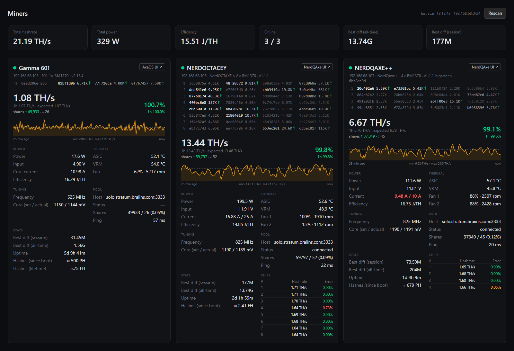
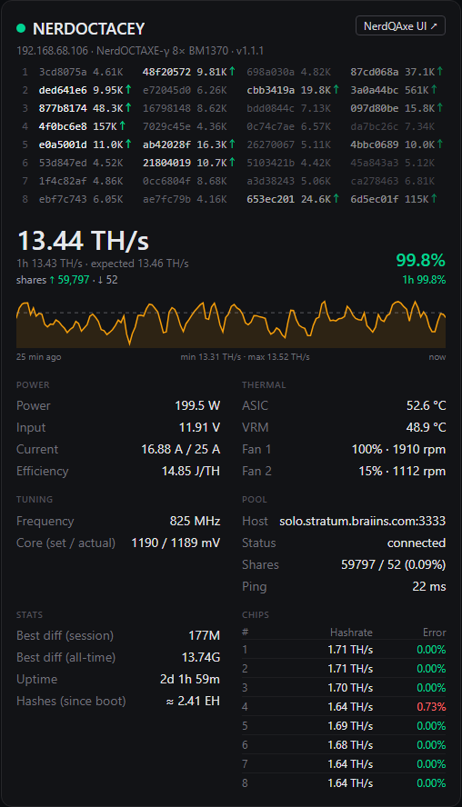
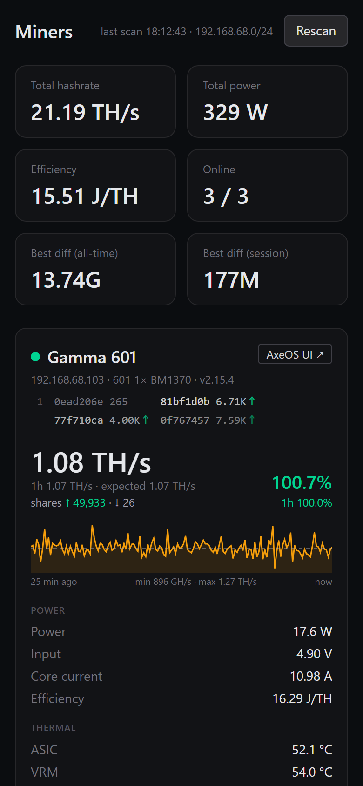

# Miner Dashboard

A local dashboard for home Bitcoin miners running AxeOS (Bitaxe) and NerdQAxe firmware.
Next.js (App Router), no database, no auth, no Docker. Read-only: it never changes miner settings.



<table>
  <tr>
    <td width="60%"></td>
    <td width="40%"></td>
  </tr>
  <tr>
    <td>Miner card: live nonce feed per chip (↑ accepted share), hashrate vs expected, shares,
    24 h chart, power, temperatures, pool, hashes since boot and per-chip error rate
    (NerdQAxe firmware).</td>
    <td>On a phone the cards stack in a single column and each chip's nonces wrap to 2×2.</td>
  </tr>
</table>

## Supported miners

Anything that exposes the AxeOS HTTP API (`GET /api/system/info`, no auth):

- **Bitaxe** (stock AxeOS): Gamma, Supra, Ultra, etc.
- **NerdQAxe / NerdQAxe++ / NerdOctaxe** (NerdQAxe firmware). These also expose
  `/api/v2/dashboard`, which adds per-chip hashrate and error stats, input current limits,
  pool connection state and more.

Tested with a NerdOctaxe (8× BM1370) and a NerdQAxe++ (4× BM1370) on NerdQAxe v1.1.1,
and a Bitaxe Gamma 601 on AxeOS v2.15.

## Features

- Summary: total hashrate, total power, overall J/TH, miners online, best difficulty
  (all-time and session).
- A card per miner:
  - online/offline status (offline after 30 s without a response)
  - current and 1 h hashrate vs expected (`frequency × smallCoreCount × asicCount / 1000`)
  - power, input voltage, current (highlighted above 90% of the max current), J/TH
  - ASIC/VRM temperature, fans
  - frequency, core voltage (set / actual)
  - pool: host, connected, fallback in use, accepted/rejected shares and reject %, ping
  - best difficulty, uptime; hashes computed since boot (estimate: average hashrate × uptime)
    and, on AxeOS 2.x, the exact lifetime counter `totalHashes` (NerdQAxe does not report one)
  - link to the miner's own web UI (AxeOS / NerdQAxe), opens in a new tab
  - live nonce feed under the IP: one row per chip (numbered like the chip table) with the
    last 4 nonces that chip found and their difficulty, so 8×4 on a NerdOctaxe, 4×4 on a
    NerdQAxe++, 1×4 on a Bitaxe (each chip's 4 become 2×2 when the card is too narrow, e.g.
    on a phone); ↑ share accepted by the pool, ↓ rejected (hover for the reason), → waiting for the answer,
    no mark: below the pool difficulty, not sent
  - shares since boot (accepted ↑ / rejected ↓) next to the hashrate
  - hashrate chart for the last 24 h (plain SVG); periods with no data (PC asleep, miner
    offline) are shown as a grey "no data" band instead of a line across the gap
  - per-chip table (NerdQAxe firmware): hashrate and error % per chip, colored
    green (0%), yellow (≤ 0.5%) or red (> 0.5%)

## How it works

- **Discovery.** The server detects the local /24 subnet(s) from the network interfaces,
  skipping virtual adapters (Hyper-V `vEthernet`, WSL, VirtualBox, VPNs). If none qualify,
  it falls back to `192.168.68.0/24` (the author's network; override it with `SCAN_SUBNETS`).
  All 254 addresses are probed with `GET /api/system/info`, at most 32 requests in parallel
  with a 1.5 s timeout. A response with `hashRate` and `ASICModel` counts as a miner. If
  `/api/v2/dashboard` also answers, the miner is typed `nerdqaxe`, otherwise `axeos`.
- **Miner list** is stored in `data/miners.json`. Miners are identified by MAC address
  (`macAddr`), falling back to hostname, so a new DHCP address updates the existing entry
  instead of creating a duplicate.
- **When it scans:** on startup if `data/miners.json` doesn't exist; when you press **Rescan**;
  and automatically when a miner hasn't answered for over a minute (at most once every
  5 minutes), to find it at its new address. If another device now answers on a miner's old IP,
  its data is not shown under that miner's name.
- **Polling.** Only the server talks to the miners (no CORS issues), every 10 s. The 24 h
  hashrate history is kept in memory (points older than 24 h are dropped) and is lost on restart.
  While the PC sleeps nothing is polled, so the chart shows a gap for that time.
- **Live feed.** The server keeps one websocket per miner to its log stream
  (`ws://IP/api/ws`, the same log the miner's web UI shows) and parses the
  "nonce found / mining.submit / pool result" lines of both firmwares (`lib/share-feed.ts`).
  The browser gets the events via server-sent events from `GET /api/feed`. If a firmware
  update changes the log format, only the feed line goes blank. Note that the ESP32 has few
  websocket slots and the dashboard holds one per miner.
- **API:** `GET /api/miners` returns the current state plus history averaged into at most
  288 time slots (5 minutes each for a full day, raw 10 s polls for the first ~48 min); slots
  with no samples are left out, so gaps stay gaps. `POST /api/rescan` runs a scan and waits for it to finish (about 10 s per /24).
- **Units.** The two endpoints disagree on units (e.g. voltage in mV vs V, current in mA vs A),
  and stock Bitaxe reports ASIC core-rail current rather than input current. Everything is
  normalized in `lib/miner-api.ts`.

## Install and build

Requires Node.js 20+ (tested on 24).

```powershell
git clone https://github.com/devstd2211/miner-dashboard.git
cd miner-dashboard
npm install
npm run build
npm start          # http://localhost:3100
```

For development: `npm run dev` (also on port 3100).

> The repo ships an `.npmrc` that pins the public npm registry (`https://registry.npmjs.org/`),
> so a global npm config pointing to a private feed doesn't break `npm install`.

## Tests (Playwright)

The e2e tests in `tests/` run against real miners on your network. If the dashboard is already
running (e.g. via autostart), they use it, otherwise they start `npm start` themselves.

```powershell
npx playwright install chromium   # once
npm run test:e2e
```

What they check:
- API: both NerdQAxe miners (8 and 4 chips) and the Bitaxe are found, no duplicates, all online.
  Units are sane: voltage in volts, 1 h hashrate within 70–130% of expected.
- UI: the page renders without console errors, shows the summary and 3 cards, and the NerdQAxe
  cards have colored per-chip tables.
- Rescan: the button runs a scan and all 3 miners are found again.
- Feed: every miner sends parsed nonces through `/api/feed` within 30 s and they appear on the cards.

A screenshot of the page is saved to `test-results/dashboard.png`. The expectations are written
for the author's three miners: adjust them at the top of `tests/dashboard.spec.ts` for your setup.

## Windows autostart

The script registers a Task Scheduler task named `MinerDashboard`. It starts **at Windows
startup** (with a 30 s delay so the network is up), even if nobody logs in, and also at user
logon. The task runs under your account in "run whether the user is logged on or not" mode
(S4U): no password is stored and the server runs with normal, non-admin rights. It runs in the
background session 0, so no window ever appears. `scripts\run-hidden.vbs` restarts the server
10 s after it exits or crashes. Output goes to `logs\server.log` (over 10 MB, the previous log is
kept as `server.old.log`).

Registering this kind of task requires admin rights: both scripts request elevation via UAC
themselves.

Enable (run `npm run build` first):

```powershell
powershell -ExecutionPolicy Bypass -File scripts\install-autostart.ps1
```

Disable (removes the task and stops the server):

```powershell
powershell -ExecutionPolicy Bypass -File scripts\uninstall-autostart.ps1
```

After updating the code, stop the server, rebuild and start it again:

```powershell
powershell -ExecutionPolicy Bypass -File scripts\uninstall-autostart.ps1
npm run build
powershell -ExecutionPolicy Bypass -File scripts\install-autostart.ps1
```

## Data and configuration

- `data/miners.json`: the discovered miners (`id`, `ip`, `hostname`, `mac`, `type`, `lastSeen`).
  Delete it to force a full scan on the next start. To forget a miner you've retired, remove
  it from this file while the server is stopped.
- `SCAN_SUBNETS`: optional environment variable for when subnet detection gets it wrong.
  Example: `SCAN_SUBNETS=192.168.68,192.168.1`.

## Project layout

```
lib/miner-api.ts   miner HTTP requests and JSON normalization (GH/s, W, V, A, °C, MHz, mV)
lib/scanner.ts     subnet detection and LAN scan
lib/store.ts       state, miners.json, 24 h history, background poller
lib/history.ts     history downsampling and gap detection for the chart
lib/share-feed.ts  websocket to each miner's log, nonce/share parsing for the live feed
instrumentation.ts starts the poller when the server starts
app/api/*          GET /api/miners, POST /api/rescan, GET /api/feed (SSE)
app/page.tsx       UI (summary + cards); components/: miner card, sparkline
scripts/           Windows autostart
tests/             Playwright e2e tests
```

## License

MIT, see [LICENSE](LICENSE).
